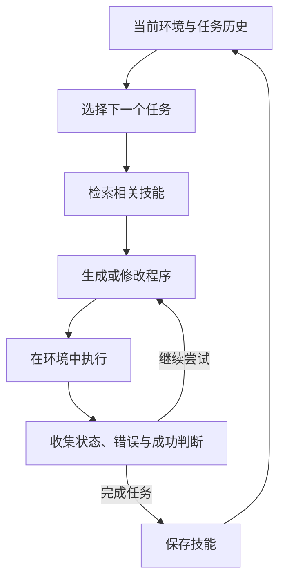

# Voyager 论文精读导读

> **2026-10-14 课堂更新：** [学习文件夹](learning/2026-10-14-voyager/README.md) · [精读修正与补充](learning/2026-10-14-voyager/精读修正与补充.md)。涉及自验证、option、实验归因和成本的旧表述，请结合更正阅读。

日期：2026-10-14

本文按“理解机制 → 检查证据 → 提出自己的判断”组织，适合边听课边对照。依据是 [Voyager 论文 arXiv v2](https://arxiv.org/html/2305.16291v2)，并结合[作者项目页](https://voyager.minedojo.org/)。文中区分论文事实与分析。

**先抓住中心命题**

Voyager 探索的是：**底层模型参数固定时，Agent 能否通过积累可执行技能，持续提高解决任务的能力？**

它在 Minecraft 中组合三个机制：自动选择任务、依据执行反馈修改程序、把成功程序存入技能库。GPT-4 不进行参数微调；技能以代码保存，通过描述的向量表示检索。[作者项目说明](https://voyager.minedojo.org/)

你可以带着下面这个问题读全文：

> 这次成功，究竟只是解决了眼前任务，还是留下了以后能复用的能力？

---

**先把系统看成两个循环**

下面是概念化整理，省略了实现细节：

**内层循环解决“这件事怎么做成”。外层循环解决“做成之后，下一次是否更有能力”。**

这个区分很重要：一个 Agent 即使会反复纠错，也可能每次都从头试错。只有当经验能够被保存、找到并正确复用时，局部成功才可能形成长期收益。

---

**读 Method 时，逐个追问三个设计**

| 模块 | 你要理解的问题 | 精读时应追问 |
|---|---|---|
| Automatic Curriculum | 下一步做什么？ | 任务难度是否匹配当前能力和资源？ |
| Iterative Prompting | 失败后怎样调整？ | 反馈是否能定位问题，而不只是报告失败？ |
| Skill Library | 成功后留下什么？ | 保存的程序在不同状态下还适用吗？ |

这三个问题分别对应**探索方向、纠错效率、经验复用**。下面是我的分析。

自动课程最值得看的地方，是**任务选择本身会影响学习效率**。假如下一步太难，预算会耗在重复失败上；如果一直选择简单任务，系统也可能停滞。读 §2.1 时，留意它怎样利用当前状态与历史来决定下一步，而不要只看生成的任务是否“合理”。

迭代反馈则需要分清三个层次：

- 程序能否运行？
- 执行是否产生了预期变化？
- 这些变化是否满足任务要求？

例如，一个“生成报表”的程序正常退出，不代表文件内容正确，更不代表业务问题得到回答。**运行成功与任务成功之间，需要单独的判断。**

技能库的关键是**复用的单位**。相比保留整段对话，保存一个有明确用途的函数，可以压缩后续决策过程。不过，这会把问题转移到函数的适用条件、依赖和组合方式上。

你可以把它理解为：系统逐渐拥有了一套自己积累的工具，但还需要判断什么时候用哪一个。

---

**“模型没变，怎么能叫学习？”**

我建议把“学习”拆成三种变化来判断：

| 变化发生在哪里 | 变化的内容 | 如何验证 |
|---|---|---|
| 模型参数 | 权重更新 | 固定外部条件，比较更新前后表现 |
| 当前上下文 | 新信息进入本次推理 | 移除这些信息，观察表现变化 |
| 外部持久状态 | 程序、记忆或策略累积 | 保持模型固定，比较有无历史积累的表现 |

Voyager 属于外部技能积累与上下文使用相结合的路线。[项目说明](https://voyager.minedojo.org/)

**我的判断是：可以称为系统层面的学习，但不能由此推断底层模型本身学到了新的参数化知识。**

用一个抽象表达式可以讲清楚：

$$
a_t = F_\theta(o_t,\;g_t,\;\operatorname{Retrieve}(M_t))
$$

这里，$\theta$ 是固定模型，$o_t$ 是当前观察，$g_t$ 是任务，$M_t$ 是不断变化的技能库。即使 $\theta$ 不变，$M_t$ 的变化也可能改变系统行为。

这是帮助理解的表达式，不是论文原公式。

但“技能库变大”只是存储事实。要证明系统学得更好，还需要看到：

> 在可比条件下，积累下来的技能提高了成功率，或降低了完成任务所需的成本。

---

**实验优先看这几处，不要只记摘要倍数**

下面这些事实足以帮助你建立阅读锚点：

| 原文位置 | 值得注意的事实 |
|---|---|
| §3.2 | 使用结构化状态和高层控制 API，不能直接等同于从画面学习底层操作 |
| Table 1 | 完整 Voyager 的钻石工具探索成功为 **1/3** |
| Table 2 | 去掉技能库后仍能完成多项任务，但完整系统通常需要更少迭代 |
| §3.4 | 去掉自验证，发现物品数下降 **73%** |
| Table 1–2 | 效率主要按 prompting iterations 衡量；实验仅有三次试验 |

另外，论文的 zero-shot 测试保留了已积累技能，并允许在新任务中迭代执行；不能理解成“一次调用、没有历史经验”。[论文 §3.2–3.4](https://arxiv.org/html/2305.16291v2#S3)

这些结果应怎样解读？以下是我的判断：

**第一，技能库的价值要看增量。**

“没有技能库也能完成”并不否定技能库，它可能主要减少重复试错、提高复杂任务效率。相反，也不能把完整系统的全部收益都归功于技能库。

**第二，自验证同时影响当前执行与未来积累。**

如果错误地判定成功，可能提前结束任务，也可能保存不可靠的经验。因此，验证模块既影响当前结果，也影响后续系统状态。

**第三，成功案例与可靠能力之间有距离。**

一次完成高难度任务证明“有可能做到”；稳定完成则需要更多重复试验和更多环境条件。

**第四，迭代次数不能直接换算成时间或费用。**

不同迭代可能有不同的上下文长度、模型调用数量和环境执行成本。工程评估需要把这些分开计算。

---

**最值得深入的一点：一次成功，为什么足以保存为技能？**

这是我建议你在课堂上重点思考的问题。

考虑一个教学示例：系统在附近有原料、工具充足时，成功执行了一个制作工具的函数。

之后环境发生变化：

- 原料距离更远；
- 背包已经有部分材料；
- 必需工具缺失；
- 函数运行到一半失败，再次执行。

原来成功的代码，在这些状态下是否仍然有效？

所以，一个更强的技能定义，可以包含：

$$
\text{技能} = \text{程序} + \text{适用条件} + \text{预期结果} + \text{验证证据}
$$

这属于我提出的工程扩展，不是说论文已经完整实现了这套定义。

从你的后端和分布式系统背景来看，这里会很熟悉：**函数可调用，不等于调用有意义；单次成功，不等于满足稳定的行为契约。**

如果继续研究，我会优先检查：

| 问题 | 可做的实验 |
|---|---|
| 是否依赖偶然环境？ | 换位置、资源分布和初始状态重复执行 |
| 检索是否找到真正可用的技能？ | 对比语义检索与人工指定正确技能 |
| 组合是否引入隐藏依赖？ | 单独执行成功后，再测试多技能串联 |
| 验证器是否误判？ | 用独立、确定性的结果检查器核对 |
| 库增大后是否退化？ | 加入相似、过时或有缺陷技能，观察表现 |

---

**和你关注的 RAG、Agent Memory 怎么连接**

可以从“检索回来什么”这个角度比较：

| 外部内容 | 帮助系统解决什么 |
|---|---|
| 文档片段 | 获得事实或背景 |
| 历史记录 | 了解以前发生了什么 |
| 反思总结 | 调整下一次尝试 |
| 可执行程序 | 直接复用一种行动方法 |

这是概念上的分类，实际系统可以混合使用。

对你而言，值得进一步研究的是**从经验到可复用行为的转换过程**：

> 执行记录 → 提炼候选技能 → 验证适用范围 → 保存 → 检索 → 再验证。

其中，“提炼”与“验证”可能比存入向量库更决定长期效果。一个持续积累错误程序的 Agent，也会拥有越来越大的技能库。

---

**今天按这个顺序精读，约 50 分钟**

| 时间 | 阅读位置 | 给自己留下的答案 |
|---|---|---|
| 5 分钟 | Abstract、Introduction | 它要解决什么已有 Agent 的不足？ |
| 15 分钟 | Figure 2、§2 | 画出一次任务如何进入、执行、结束、入库 |
| 10 分钟 | Table 1、Table 2 | 技能库具体增加了哪些收益？ |
| 10 分钟 | §3.4、Figure 9 | 哪个消融最改变你对系统的理解？ |
| 10 分钟 | §4、附录 A.1 与验证提示词 | 它依赖哪些假设，在哪里可能失效？ |

课堂上可以直接问这三个问题：

1. **技能进入库之前，只验证当前任务成功，还是验证跨状态复用能力？**
2. **如果把技能检索换成理想检索，性能还能提高多少？瓶颈究竟在检索、生成还是执行？**
3. **如果按总 token、实际时间和费用匹配预算，实验优势是否保持？**

读完后，你应该能独立回答：**Voyager 把哪些原本需要重新推理和试错的工作，转化成了可以持久保存、再次调用的能力；而实验对这种能力的可靠性证明到了哪一步。**
