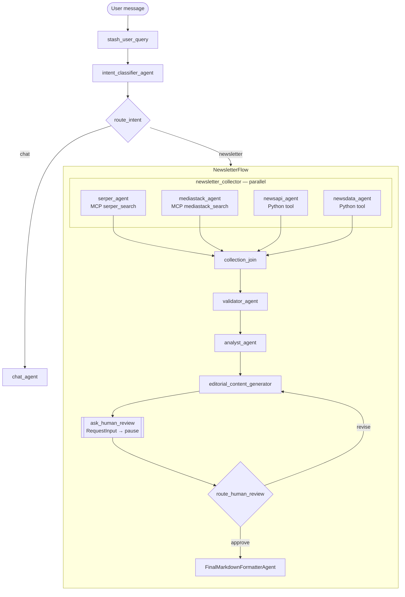

# 📰 Newsletter Generation with Google ADK 2.x — Lab Guide

A multi-agent newsletter pipeline built with the **Google Agent Development Kit (ADK) 2.x**.
Ask a quick question and a chat agent answers; ask for a newsletter and a graph of agents
collects news from four APIs in parallel, validates it, analyzes it, writes an editorial,
**pauses for your approval**, and formats it as Markdown.

**What you will learn**

| ADK concept | Where to look |
|---|---|
| `Workflow` graphs (`START`, edges, nesting) | `src/newsletter/agent.py` |
| Parallel fan-out / fan-in with `JoinNode` | `sub_agents/newsletter_collector/agent.py` |
| Conditional routing with `Event(route=...)` | `sub_agents/intent_router/agent.py` |
| Human-in-the-loop with `RequestInput` + resumable `App` | `sub_agents/human_review/agent.py` |
| MCP tools via `McpToolset` + FastMCP | `mcp/fastmcp_server.py` |
| Structured output with `output_schema` (Pydantic) | `src/newsletter/schemas.py` |
| State passing with `output_key` and `{placeholders}` | every `prompt.py` |
| Tracing with Phoenix / OpenTelemetry | `agent.py`, http://localhost:6006 |

---

## 🗺️ Architecture



### State keys (how agents talk to each other)

Each agent writes its result to session state under its `output_key`; later prompts read it
with a `{key}` placeholder (`{key?}` means optional).

| State key | Written by | Read by | Shape |
|---|---|---|---|
| `user_query` | `stash_user_query` | classifier, chat agent, `route_intent` | text |
| `intent` | `intent_classifier_agent` | `route_intent` | `newsletter` / `chat` |
| `serper_articles`, `mediastack_articles`, `newsapi_articles`, `newsdata_articles` | collector agents | `validator_agent` | text |
| `validated_reports` | `validator_agent` | analyst, editorial | `ValidatedReports` |
| `analysis_report` | `analyst_agent` | editorial | `AnalysisReport` |
| `editorial_draft` | editorial agent | HITL, formatter | Markdown |
| `review_count`, `human_feedback` | `route_human_review` | HITL, editorial (`{human_feedback?}`) | int / text |
| `final_markdown_output` | `FinalMarkdownFormatterAgent` | Streamlit / CLI | Markdown |

`ValidatedReports` and `AnalysisReport` are Pydantic models in `src/newsletter/schemas.py`.
Passing them as `output_schema` makes ADK validate the model's JSON and store a dict in state.
`url_format_ok` only means the URL *looks* well-formed (heuristic), not that the page was opened.

---

## ⚙️ Setup

```bash
uv sync                      # installs the pinned versions from uv.lock
cp .env.example .env         # then fill in the keys and paths
```

Keys needed: LLM keys for your chosen provider, plus `SERPER_API_KEY`, `NEWSAPI_API_KEY`,
`NEWSDATA_API_KEY`, `MEDIASTACK_API_KEY`. Shared knobs (provider, model, MCP address) live in
`src/newsletter/settings.py` and can be overridden from `.env`.

## ▶️ Run order (three terminals)

**1. Phoenix (tracing UI)**

```bash
uv run phoenix serve         # http://localhost:6006
```

Not using Phoenix? Set `ENABLE_TRACING=false` in `.env`. With tracing on and no Phoenix
running, every span export waits on retries and a simple chat reply can take over a minute.

**2. MCP tool server** (Serper search + MediaStack)

```bash
uv run src/newsletter/mcp/fastmcp_server.py      # http://127.0.0.1:9000/mcp
```

**3. Pick a front end**

```bash
cd src && uv run adk web                          # ADK dev UI → choose "newsletter"
uv run streamlit run src/newsletter/app.py        # Streamlit UI
uv run src/newsletter/agent_runner.py             # terminal / CLI
```

Try a chat message first (`What is a neural network?`) — it should answer in seconds without
calling any news tools. Then ask `Generate a newsletter about Deep Neural Networks`.

### Human review (HITL)

After the editorial draft is written the run **pauses**. Reply with:

- `approve` → continue to final formatting
- `revise: <your notes>` → the editorial agent rewrites using your notes, then asks again

In `adk web` type the reply in the chat box; Streamlit shows a form; the CLI prompts you.
Under the hood the UI sends a `FunctionResponse` named `adk_request_input` with the pause's
`id`, and the resumable `App` continues from where it stopped (see `agent_runner.py`).

---

## 🛠️ Troubleshooting

| Symptom | Fix |
|---|---|
| `Failed to create MCP session: All connection attempts failed` | Start the MCP server (step 2). |
| Everything is very slow | Start Phoenix or set `ENABLE_TRACING=false`. |
| A simple question runs the whole pipeline | Tighten `INTENT_CLASSIFIER_INSTRUCTION` in `sub_agents/intent_router/agent.py`. |
| `approve` asks for review again | Make sure the reply goes to the *latest* pause; each round has its own `interrupt_id`. |
| Empty / thin `validated_reports` | Check API keys; the validator may have dropped off-topic or low-reputation URLs. |

## References

* [Google ADK documentation](https://google.github.io/adk-docs/)
* [Phoenix observability](https://github.com/Arize-ai/phoenix)
* [FastMCP](https://gofastmcp.com/)
* [Serper](https://serper.dev/)
* [Streamlit](https://streamlit.io/)
