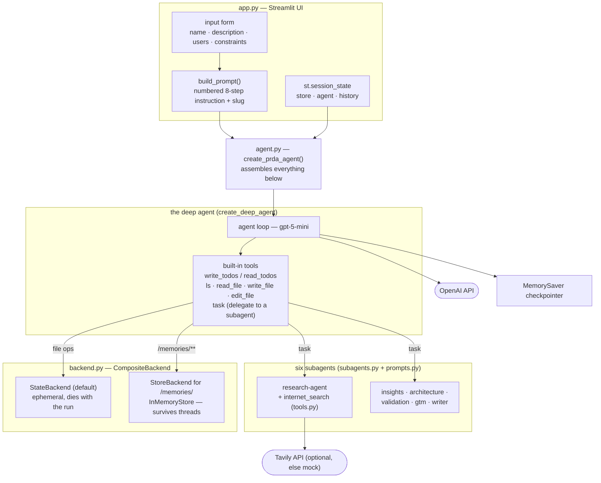
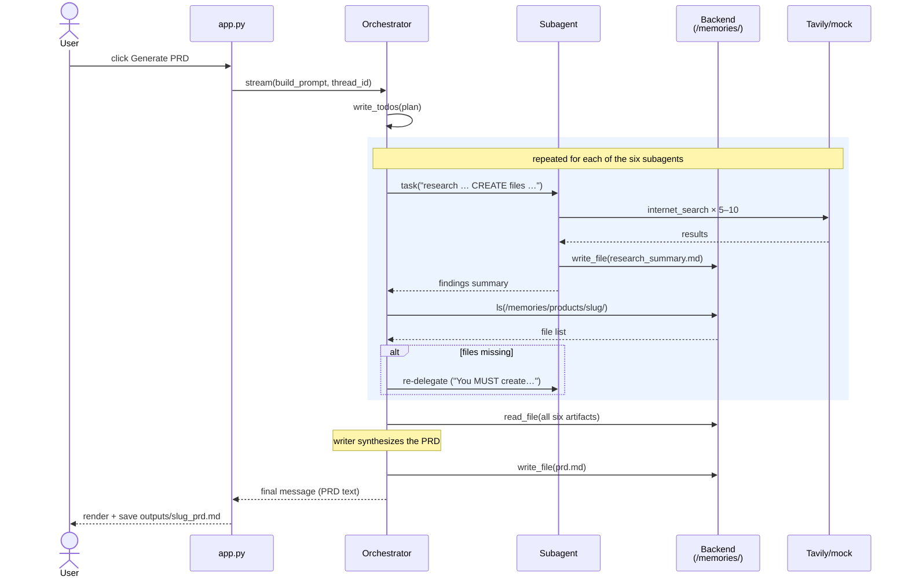

# DeepAgents: from agent loop to harness

Two notebooks and one application built on [deepagents](https://docs.langchain.com/oss/python/deepagents),
LangChain's deep-agent harness on top of LangGraph.

Chapter 8 built the pieces of a harness by hand — memory, skills, tool-policy
gates. This lab shows the same concerns as *configuration* on one factory
call, then assembles them into a working product: **PRDA**, a Product
Research & Development Assistant that turns a product idea into a full PRD
through a pipeline of six subagents.

## What's here

```
ch09-01_deepagents_prda/
├── docs/notebooks/
│   ├── 01_deepagents_basics.ipynb    # the core: agent loop, planning/TODOs,
│   │                                 #   virtual filesystem + /memories/ store,
│   │                                 #   subagents, human-in-the-loop
│   └── 02_deepagents_harness.ipynb   # the harness: skills=, memory= (AGENTS.md),
│                                     #   permissions= (allow/deny/interrupt),
│                                     #   ToolRetryMiddleware, built-in compaction
└── src/deepagents_basics/            # PRDA, the capstone application
    ├── app.py                        # Streamlit UI
    ├── agent.py                      # create_prda_agent() factory + CLI demo
    ├── prompts.py                    # orchestrator + 6 subagent prompts
    ├── subagents.py                  # research / insights / architecture /
    │                                 #   validation / GTM / writer
    ├── tools.py                      # internet_search (Tavily, or a mock
    │                                 #   result when no key is set)
    ├── backend.py                    # CompositeBackend: ephemeral state +
    │                                 #   persistent /memories/ (StoreBackend)
    └── utils.py                      # slugify
```

## Setup

```bash
uv sync
cp .env.example .env     # set OPENAI_API_KEY; TAVILY_API_KEY is optional
```

LLM endpoint options (defaults target hosted OpenAI):

- **(a) OpenAI hosted (default):** model `gpt-5-mini`, `OPENAI_API_KEY` required.
- **(b) self-hosted OpenAI-compatible server (vLLM / Ollama):** pass a
  configured model instance instead of a string, e.g.
  `ChatOpenAI(model="openai/gpt-oss-20b", base_url="http://10.0.10.70:8000/v1", api_key="not-needed")`,
  to `create_prda_agent(model=...)` or in the notebooks' model cell.

Without a `TAVILY_API_KEY`, the `internet_search` tool returns a clearly
labeled mock result, so everything still runs end to end — the PRD is just
built from the model's own knowledge instead of live search.

## The notebooks

Run **01** first: it builds up `create_deep_agent` from a bare research agent
to planning/TODO visualization, the virtual filesystem with a persistent
`/memories/` route, subagents, and human-in-the-loop interrupts.

Then **02** adds what makes deepagents a *harness* (each is one parameter):
`skills=` (SKILL.md folders with progressive disclosure — the ch08-02 pattern),
`memory=` (always-loaded AGENTS.md context — the OpenClaw/Hermes pattern),
`permissions=` (declarative allow/deny/interrupt rules on the file tools — the
DSH-lab veto in one line), and `ToolRetryMiddleware` (automatic backoff-retry
of raised tool errors), plus the pieces you get without asking: summarization
compaction and tool-call repair.

## The PRDA app

```bash
cd src/deepagents_basics
uv run streamlit run app.py --server.port 8501
```

Open http://localhost:8501, describe a product, and generate a PRD. The
pipeline (research → insights → architecture → validation → GTM → writer)
typically takes 10–20 minutes; a live status log shows every plan update,
delegation, search and file write as it happens. Artifacts land under
`/memories/products/<slug>/` in the agent's store — which is **in-memory**, so
it dies with the process. The finished PRD is therefore also written to
`outputs/<slug>_prd.md` on disk and offered as a download in the UI; within a
running session, `/memories/` is also why a second run can read the first
run's files.

The CLI variant of the same run:

```bash
uv run python -m deepagents_basics.agent
```

## Code architecture



Two structural points worth pausing on. Everything inside the deep-agent box
is **built in** — the lab's own code contributes only the system prompts, one
custom tool, the six subagent specs, and the backend routing; `create_deep_agent`
supplies the loop, planning, filesystem, and delegation machinery. And the
storage split is the memory lesson from chapter 8 again: scratch files live in
ephemeral state, while everything written under `/memories/` crosses thread
boundaries, which is why a second run in the same app session can read the
previous run's PRD.

## Code walkthrough: one click, end to end

**Setup — once per browser session** (`app.py`):

```
st.session_state.store  = InMemoryStore()          # shared across ALL runs in this session
st.session_state.agent  = create_prda_agent(model="openai:gpt-5-mini",
                                            store=st.session_state.store)
    └─ agent.py: create_prda_agent()
       ├─ checkpointer = MemorySaver()             # short-term: per-conversation state
       ├─ subagents    = build_subagents()         # subagents.py: 6 specs, prompts from prompts.py
       └─ create_deep_agent(
             model=...,                            # "openai:gpt-5-mini"
             system_prompt=MAIN_SYSTEM_PROMPT,     # the delegate -> verify -> re-delegate playbook
             backend=make_backend(store),          # backend.py: state + /memories/ store routing
             store=store, subagents=subagents,
             tools=[internet_search],              # tools.py: Tavily or labeled mock
             checkpointer=checkpointer)
```

**Per click** (`run_button`):

```
slug   = slugify(product_name)                     # utils.py: "AI Budgeting..." -> "ai_budgeting_..."
prompt = build_prompt(...)                         # the numbered 8-step instruction, slug pinned
config = {"configurable": {"thread_id": uuid4()}}  # FRESH thread: no chat history carries over
for ns, update in agent.stream({...}, config,     # streamed, not invoke(): every yielded
        stream_mode="updates", subgraphs=True):    #   update becomes a line in the live log
    _log_update(status_log, ...)                   # plans, delegations, searches, file writes
final = agent.get_state(config).values["messages"][-1]   # final state via the checkpointer
    -> appended to st.session_state.history, rendered with st.markdown
```

Everything interesting happens inside that stream loop: the orchestrator
(driven by `MAIN_SYSTEM_PROMPT`) plans, delegates to one subagent at a time via
the built-in `task` tool, and after each delegation runs `ls` on
`/memories/products/<slug>/` to **verify the promised files exist** before
moving on — re-delegating with firmer wording when they don't. That
verify-after-each-step loop is the prompt-engineering heart of the app.

The CLI (`uv run python -m deepagents_basics.agent`) is the same flow minus
Streamlit: `demo_prda_run()` hardcodes the budgeting-assistant example, builds
the same prompt, and prints the final message — useful for watching the run in
a terminal.

### Sequence: what one submission triggers



The subagents after research follow the same shape without the Tavily arrows:
each reads its predecessors' files from `/memories/`, writes its own, and the
orchestrator verifies. Only `research-agent` can search; the writer only reads
and writes. In the UI, every arrow in this diagram surfaces as a line in the
live status log — the run takes minutes, but you watch the plans, delegations,
searches and verification `ls` calls as they happen (`subgraphs=True` is what
lets subagent-internal events through). The CLI variant still uses one
blocking `invoke`, so it is silent until the end — run both once and the
difference *is* the lesson about streaming from a LangGraph graph.

## Startup noise

If the terminal or a notebook shows `[ERROR] ... is part of
...ImageProcessorKwargs, but not documented` lines at startup, **ignore
them** — they are harmless. They are the `transformers` library validating
its own docstrings at import time; it arrives transitively (langchain-core
imports it whenever it is installed; it is installed here via
`svlearn-bootcamp`) and this lab never calls it. The messages are plain
`print()` output from inside transformers, so they cannot be silenced by
logging configuration; they disappear as upstream transformers releases fix
their own docstrings.

## Version note

The code targets `deepagents >= 0.7` (pinned in `pyproject.toml`). The 0.7
line changed the API from early releases: backends are passed as instances
(`StateBackend()`, `StoreBackend(namespace=..., store=...)`) rather than
runtime-taking factories, and `skills` / `memory` / `permissions` exist as
first-class parameters. If an upgrade breaks something, start from
`create_deep_agent`'s docstring — it documents the full middleware stack.

## License

This lab is part of the AI Lab Book companion repository and is released under the
MIT License — see the LICENSE file at the repository root.
