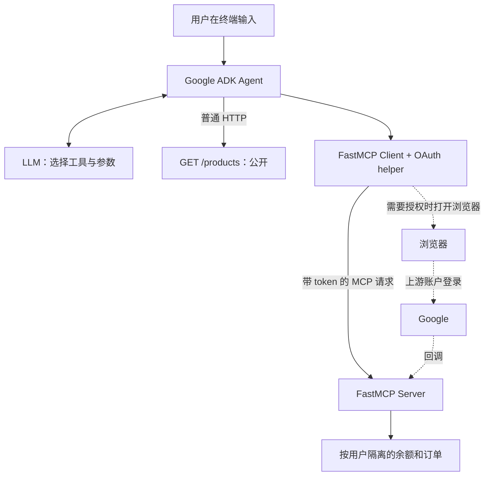

# Google ADK + MCP + Google OAuth 学习笔记

记录日期：2026-10-29。状态：**源码与项目说明阅读，尚未运行或验证认证流程**。本笔记整理本聊天的完整讲解；业务行为依据本地源码，协议交换细节标注为项目文档描述，不把框架行为或说明当作实测结果。

## 1. 今天讲什么，与上次 lab 的关系

本项目是带登录的模拟商店：Agent 可以列商品、购买、查看自己的订单、退款。学习重点是让 ADK 调用需要认证的 MCP 工具，并把业务操作绑定到真正登录的用户。

- 上次 MCP Guardrails：模型被诱导后，哪些文件仍不能读？如何清洗工具描述和结果？
- 本次 OAuth：调用者是谁？能操作谁的订单？
- OAuth/身份绑定不自动解决 prompt injection，也不自动表达每笔交易是否得到用户批准。

没有真实支付。余额、订单保存在进程内的 Python 字典，服务器重启会清空。

## 2. 资料与代码入口

| 文件 | 内容 |
| --- | --- |
| [README](google_adk_mcp_oauth/README.md) | 目标、配置与两终端运行方式 |
| [Flow Explained](google_adk_mcp_oauth/README_Flow_Explained.md) | 两段授权、两种 token、发现、PKCE、回调等预期流程 |
| [Google Console Setup](google_adk_mcp_oauth/README_Google_Console_Setup.md) | 创建 Google OAuth 应用和凭据的项目说明 |
| [server.py](google_adk_mcp_oauth/src/mcp_server/server.py) | 模拟商店、认证 provider、公开 HTTP route、受保护 MCP tools |
| [agent.py](google_adk_mcp_oauth/src/playground/agent.py) | FastMCP 客户端、ADK 包装工具、模型与终端对话循环 |
| [pyproject.toml](google_adk_mcp_oauth/pyproject.toml) | Python ≥3.12 与依赖；FastMCP 指向指定 Git commit |

说明中的版本/规范链接未在本次独立联网核实。FastMCP 在 `tool.uv.sources` 固定到 `92c4c8d7f02c25127767fc79dafc0e7bdbf7f0e8`；实际行为需结合安装到的该版本核实，不能仅看依赖列表的最低版本。

## 3. 架构与职责



ADK 管对话、模型与工具调度；FastMCP 管工具协议和认证接入；Google 提供上游账户登录。模型没有负责验证 token，也不需要在自然语言上下文里携带 token。

服务进程兼任两种角色：Resource Server 提供受保护 MCP 资源；Authorization Server facade/proxy 把 Google 登录接到 MCP 客户端授权上。两种角色共处一个进程，不代表概念相同。

## 4. 服务端：模拟数据库和认证接入

`server.py` 的商品与数据结构：

```python
PRODUCTS = {
    "p1": {"name": "Pro Plan", "price": 10.0},
    "p2": {"name": "Premium Plan", "price": 25.0},
}
USER_BALANCES: dict[str, float] = {}
USER_ORDERS: dict[str, list] = {}
```

余额和订单都按登录身份索引，不按模型指定的名字索引。配置默认 `RS_BASE_URL=http://localhost:8026`，`MCP_PATH=/mcp`，Google 回调路径 `/auth/callback`。监听 host 默认 `0.0.0.0`，不是只监听 loopback；这里是本地 demo，部署时需单独处理监听范围和 HTTPS。

认证接入的核心代码：

```python
google_auth = GoogleProvider(
    client_id=GOOGLE_CLIENT_ID,
    client_secret=GOOGLE_CLIENT_SECRET,
    base_url=BASE_URL,
    redirect_path=REDIRECT_PATH,
    required_scopes=REQUIRED_SCOPES,
    allowed_client_redirect_uris=ALLOWED_CLIENT_REDIRECTS,
)

mcp = FastMCP(
    name="MCP RS with Google OAuth",
    instructions=(
        "Protected MCP server that delegates OAuth to Google via a DCR-capable proxy."
    ),
    auth=google_auth,
)
```

`auth=google_auth` 把认证交给框架。项目没有手写全部授权端点、token 验证或 code exchange；这些在依赖库中。本次没有进一步逐项审计其实现。

默认 scopes：`openid`、Google userinfo.email、userinfo.profile，用于身份资料；它们不是应用自己的 `purchase` / `refund` 权限。

## 5. 四种操作与公开/受保护边界

| 操作 | 接口 | 实际职责 |
| --- | --- | --- |
| 列商品 | `GET /products`，`@mcp.custom_route` | 返回 p1/p2 与价格，设计为不需认证 |
| 购买 | `purchase_item(item_id)`，`@mcp.tool` | 验证身份/商品/余额，扣款，创建交易 |
| 查订单 | `view_my_orders()`，`@mcp.tool` | 返回当前身份下的订单 |
| 退款 | `refund_purchase(transaction_id)`，`@mcp.tool` | 只在当前身份订单中查找并退款 |

README 用“Public Tool”描述商品列表，但服务端实际是普通 HTTP route，**不是 MCP tool**；客户端把这段 HTTP 调用包装成了 ADK tool。

### 5.1 身份由认证上下文决定

```python
@mcp.tool()
async def purchase_item(item_id: str) -> dict[str, Any]:
    from fastmcp.server.dependencies import get_access_token

    token = get_access_token()
    user_id = token.claims.get("sub")
    email = token.claims.get("email")
    name = token.claims.get("name")
```

这里只接受 `item_id`，没有 `user_id` 参数。模型决定买什么，服务端依据已认证上下文决定谁在买。`sub` 用作用户主键，email/name 用于展示。代码读取 claims，不代表由业务函数自己完成签名验证；验证责任在认证层。

购买流程：

1. `sub` 缺失则返回 Invalid authentication。
2. 商品不存在则返回 Invalid product。
3. 用户首次购买时初始化模拟余额 100。
4. 不足则返回 Insufficient funds；否则扣减余额。
5. UUID 生成交易号，记录商品、金额、用户显示信息、UTC 时间和 completed 状态。
6. 添加到 `USER_ORDERS[user_id]`，返回交易与剩余余额。

```python
if user_id not in USER_BALANCES:
    USER_BALANCES[user_id] = 100.0

# 余额检查通过后：
USER_BALANCES[user_id] -= price
USER_ORDERS.setdefault(user_id, []).append(transaction)
```

顺序调用示例（预期，未实测）：首次买 p1 后余额 90，再买 p2 后 65。

### 5.2 查订单

`view_my_orders()` 不接受用户参数，从 token 取 `sub` 后返回 `USER_ORDERS.get(user_id, [])`。ADK 无需询问用户输入身份编号。

### 5.3 退款的授权边界

```python
orders = USER_ORDERS.get(user_id, [])

for order in orders:
    if order["transaction_id"] == transaction_id:
        if order["status"] == "refunded":
            return {"error": "Already refunded"}

        order["status"] = "refunded"
        USER_BALANCES[user_id] += order["amount"]
```

先按认证用户缩小到他的订单集合，再查交易号。传入别人的 transaction_id 不会让这段代码遍历别人的订单；当前用户集合里找不到则返回 Transaction not found。

认证回答“是谁”；这里的业务数据访问规则回答“能操作谁的订单”。重复退款用 status 阻止再次返款，但不是持久化交易系统的完整幂等/事务设计。

## 6. 客户端：手工包装工具给 ADK

这次不用前一个 lab 的 `McpToolset` 自动接工具目录，而是手写 Python wrappers。

### 6.1 OAuth helper 与统一 MCP 调用

```python
mcp_oauth = McpOAuth(mcp_url=MCP_URL)

async def _mcp_call(tool_name: str, args: dict | None = None) -> dict:
    async with McpClient(MCP_URL, auth=mcp_oauth) as c:
        res = await c.call_tool(tool_name, args or {})
        data = _calltool_result_to_json(res)
        return data if isinstance(data, dict) else {"result": data}
```

每次调用创建客户端上下文，共用 OAuth helper。认证交给 helper；`call_tool` 执行远程工具；结果再转为 ADK 可用的 dict。

`_calltool_result_to_json` 遍历 `result.content`：遇到 json 内容取 data；遇到 text 尝试 `json.loads`；无法解析则继续，最后返回 None。它不是完整的任意 MCP 内容处理器；当前代码未显式优先读取 structured content，多内容块只取首个可处理结果，需结合实际返回格式验证。

### 6.2 三个受保护包装函数

```python
async def mcp_purchase_item(item_id: str) -> dict:
    return await _mcp_call("purchase_item", {"item_id": item_id})

async def mcp_view_my_orders() -> dict:
    return await _mcp_call("view_my_orders")

async def mcp_refund_purchase(transaction_id: str) -> dict:
    return await _mcp_call(
        "refund_purchase", {"transaction_id": transaction_id}
    )
```

这是省略 docstring 的摘录。包装层只映射工具名与参数，不向模型开放任意用户身份。

### 6.3 商品列表直接走 HTTP

`http_list_products` 从 MCP_URL 生成 `/products` URL，用 `httpx.AsyncClient.get` 读取，超时 5 秒，HTTP 错误调用 `raise_for_status()`，成功后返回 JSON。不使用 OAuth helper。

### 6.4 Agent、Runner 与终端循环

```python
agent = LlmAgent(
    name="mcp_store_agent",
    model=LiteLlm(
        model="openai/openai/gpt-oss-20b",
        api_base="http://10.0.10.70:8000/v1",
        api_key="dummy",
    ),
    tools=[
        http_list_products,
        mcp_purchase_item,
        mcp_view_my_orders,
        mcp_refund_purchase,
    ],
    instruction=...,  # 此处省略原文件的路由说明
)
```

ADK 是框架，不代表必须使用 Gemini；当前代码走 LiteLLM，连课程内网的 gpt-oss-20b。README 中 `OPENAI_API` 配置未被这段硬编码模型配置使用。

`main()` 先创建 InMemorySessionService 会话，再循环 `input()`。`run_turn()` 把输入转成 `types.Content`，消费 `runner.run_async()` 的事件，并提取最终文本。`exit` / `quit` 退出，调用异常打印为 `[error] 类型: 信息`。

默认是终端 REPL，不是 `adk web`。

**两种 user_id 不要混淆：** `agent.py` 的 `USER_ID` 默认 user1，只给 ADK 会话管理使用；`server.py` 的 `user_id` 来自认证 token 的 sub，决定交易归属。客户端 `.env` 改 USER_ID 不等于切换 Google 登录账户。

## 7. OAuth 流程：项目文档描述，未抓包验证

### 两种 token

| 凭据 | 持有者 | 用途 |
| --- | --- | --- |
| Google access token | 服务端 | 读取上游 Google 用户信息 |
| FastMCP token（文档称 JWT） | MCP 客户端 | 访问受保护 MCP 资源 |

按项目说明，客户端不直接拿 Google access token 调本地 MCP。Google token 和 FastMCP token 的用途、签发方和接收方不同。服务端注释里“require valid Google bearer token”的措辞容易误导，应结合专门的 Flow 文档理解这两段关系。

### 一次首次授权的预期顺序

1. 无认证时请求受保护 MCP，收到 401 和 WWW-Authenticate。
2. 客户端从 challenge 发现 protected-resource metadata 与所需 scopes，再找到 authorization-server metadata。
3. 本地客户端通过动态注册（DCR）登记 callback；文档描述允许 localhost/127.0.0.1 的本地回调。
4. 客户端发起带 state、PKCE challenge、resource 和 scopes 的授权请求，打开浏览器。
5. 本地授权服务显示 consent，再转到 Google 登录/同意页面。
6. Google 回调服务端 `http://localhost:8026/auth/callback`，带 Google 授权码。
7. 服务端用 Google client credentials 换上游 token，并保留它；再向客户端 callback 返回另一枚授权码。
8. 客户端核对 state/issuer，携带 PKCE verifier 和 resource 换取用于 MCP 的 token。
9. 客户端带 Bearer token 重试 MCP 调用；服务端认证层验证后，业务函数按当前身份执行。

这九步是文档宣称的流程，不是业务文件逐行实现或已通过的协议测试。缓存凭据存在时可能不再出现完整首次登录过程。

### 两个 callback

```text
Google → http://localhost:8026/auth/callback
本地授权服务 → 客户端 localhost:<动态端口>/callback
```

Google Console 中配置的是第一个；不是把客户端随机端口直接当成 Google OAuth 回调。

### 名词速查

- PKCE：授权开始时提交 challenge，换 code 时提交 verifier，把兑换绑定到发起客户端；文档采用 S256。
- state：关联发起与回调，防止错误会话/请求混入。
- resource：客户端说明希望访问哪一个 MCP 资源。
- aud：token 面向的资源；本项目说明是 `http://localhost:8026/mcp`。
- iss：签发者身份，不要把相近但不同的 URL 当同一个 issuer。
- scope：授权范围；本例默认是身份资料范围，不是购买审批。
- DCR：动态注册客户端，与在 Google Console 手工创建上游 OAuth app 是两件事。

## 8. 运行准备（命令摘自项目结构，尚未执行）

Google Console 配置参见项目 setup 文档：创建 Web application OAuth client，把 `http://localhost:8026/auth/callback` 配成 redirect URI。Console UI 和账户发布/测试限制需运行时核对。

`.env` 中设置 GOOGLE_CLIENT_ID、GOOGLE_CLIENT_SECRET、RS_BASE_URL、MCP_URL。不要把真实 secret 或 token 写入笔记。模型地址当前是课程内网地址，需确认网络可达。

终端 1：

```bash
cd "/Volumes/DOCK1TBFILES/AI/AI Agents/course/ai-agents-week-06/google_adk_mcp_oauth"
uv sync
uv run src/mcp_server/server.py
```

终端 2：

```bash
cd "/Volumes/DOCK1TBFILES/AI/AI Agents/course/ai-agents-week-06/google_adk_mcp_oauth"
uv run src/playground/agent.py
```

交互顺序：`list products` → `buy p1` → `view my orders` → `refund <实际返回的transaction_id>`。首次受保护调用预期触发浏览器授权；是否成功需记录实际结果。

## 9. 这个 demo 的边界

1. 登录认证不等于逐笔批准；当前没有独立的购买审批步骤。
2. 默认 Google 身份 scopes 没有区分本应用的只读/购买/退款角色权限。
3. 购买没有幂等键；重复调用可能重复扣模拟余额。UUID 交易号不会自动阻止重复请求。
4. 退款状态检查阻止顺序重复返款，但没有持久化事务系统。
5. 订单和余额是单进程内存；重启丢失，也没有共享数据库支持多副本。
6. 金额使用 float，是 demo 简化，不能据此当作正式账务实现。
7. 身份校验依赖框架正确验证 token；业务代码提取 claims 并不能替代签名、issuer、audience、expiry 检查。
8. OAuth 不消除工具注入，也不能证明每个经认证动作都符合用户当前意图。

## 10. 推荐读代码顺序与待验证清单

先读 purchase_item 如何取身份，再读 refund_purchase 如何限制订单归属，再看客户端 _mcp_call，最后把 OAuth 的两个回调和两种 token 串起来。

- [x] 阅读三份说明和两个主要业务 Python 文件。
- [x] 区分公开 HTTP route、ADK tool wrapper 和 MCP tool。
- [x] 分析 sub 身份绑定及退款访问边界。
- [ ] 安装依赖并核对实际版本。
- [ ] 无登录访问 `/products` 成功。
- [ ] 无 token 请求受保护 MCP 被拒绝并提供发现信息。
- [ ] 首次授权完成，记录两个回调和请求顺序（不记录 token 值）。
- [ ] 买 p1、查自己的订单、退款，确认余额变化。
- [ ] 再次退款被拒绝且余额不重复增加。
- [ ] 使用两个测试账户确认不能退款另一账户的订单；ADK USER_ID 不当作账户切换证据。
- [ ] 失效/错误 token 的拒绝行为及 token audience/issuer 检查。
- [ ] 重启后的状态清空，确认 demo 限制。

实验结果：待补；本次没有启动服务器、登录 Google 或发起交易。
