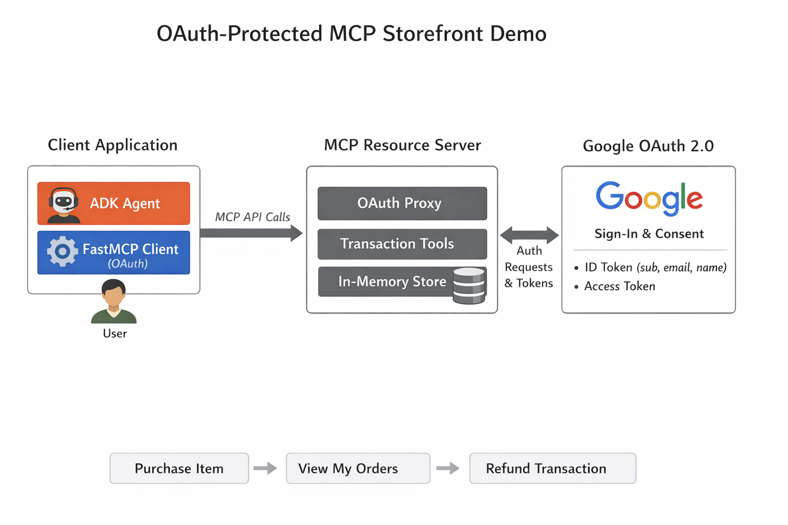

---

# 🚀 OAuth-Protected MCP Storefront Demo

## Objectives

1. Implement OAuth-protected MCP server tools for authenticated operations
2. Expose both authenticated and unauthenticated tools via a single server
3. Integrate Google ADK with the MCP client–server architecture

---

This project demonstrates:

* ✅ Google OAuth 2.0 authentication
* ✅ MCP (Model Context Protocol) server
* ✅ OAuth-protected transaction tools
* ✅ Google ADK agent client
* ✅ Identity-bound purchases & refunds

---

# 🏗 Architecture Overview



---

# 📦 Features

### 🌍 Public Tool

* `list_products`

### 🔐 OAuth-Protected Tools

* `purchase_item`
* `view_my_orders`
* `refund_purchase`

Each authenticated request:

* Reads `sub`, `email`, and `name` on the server after checking the client's FastMCP JWT
* Stores transactions per user
* Maintains in-memory balance

⚠ Data resets when server restarts (demo only).

---

# 📚 Documentation

- [Flow & Architecture](README_Flow_Explained.md) — End-to-end flow and system design
- [Google Cloud Console Setup](README_Google_Console_Setup.md) — OAuth credentials and consent screen configuration

---

# ⚙ Environment Setup

Create a `.env` file:

```env

OPENAI_API=your_openai_api

GOOGLE_CLIENT_ID=your_client_id
GOOGLE_CLIENT_SECRET=your_client_secret

RS_BASE_URL=http://localhost:8026
MCP_URL=http://localhost:8026/mcp
```

---

# ▶ Running the System

Open two terminals.

---

## 🖥 Terminal 1 — Start MCP Server

```bash
uv sync

uv run src/mcp_server/server.py
```

---

## 🤖 Terminal 2 — Start Agent Client

```bash
uv run src/playground/agent.py
```

---

# 🔗 Resources

- [MCP Authorization — Authorization Flow Steps](https://modelcontextprotocol.io/specification/2026-07-28/basic/authorization#authorization-flow-steps) — OAuth 2.1 flow for HTTP-based MCP transports
- [mcp_streamable_http](https://github.com/theailanguage/mcp_streamable_http) — Educational repo for OAuth-protected MCP servers and clients
- [Model Context Protocol](https://modelcontextprotocol.io) — MCP specification and documentation

---
