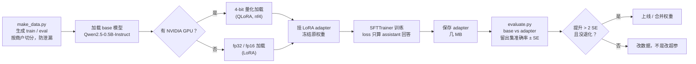
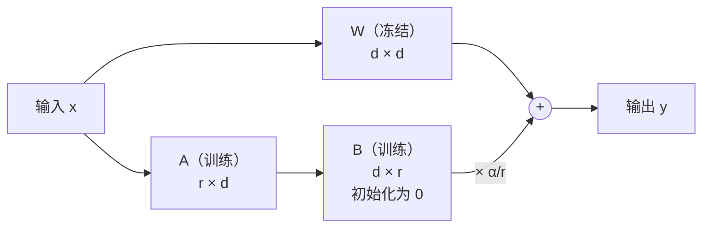

# 微调入门：LoRA / QLoRA（2026-11-15）

> 起因：W9 课上讲 frontier vs open-weight 模型，想弄清「微调权重」到底怎么做。
> 先记住 W8 的地图：**缺信息 → 改 prompt；缺知识 → 检索 / memory；缺能力 → 才微调。** 微调最贵、最难撤回，放在最后。

## 文件

| 文件 | 作用 |
| --- | --- |
| `make_data.py` | 生成玩具数据：商户便签 → `{"merchant","category"}` JSON（类似 W8 House Taxonomy） |
| `train_lora.py` | 用 TRL `SFTTrainer` 做 LoRA（Mac/CPU）或 QLoRA（NVIDIA GPU） |
| `evaluate.py` | base vs base+adapter 在**留出集**上比准确率（带标准误） |
| `requirements.txt` | 依赖 |
| `data/` | `train.jsonl` 288 条（48 个商户）/ `eval.jsonl` 60 条（另外 12 个商户，**训练时从没见过**） |

## 1. 全流程（设计图）



## 2. LoRA 在做什么（核心原理）

原来的一层线性层：$y = Wx$，$W$ 是 $d \times d$（比如 896 × 896）。

全量微调：直接改 $W$ → 要存一整份新权重 + 优化器状态（Adam 每个参数还要 2 份），显存爆炸。

LoRA：**$W$ 冻结不动**，旁边加两个小矩阵 $A$（$r \times d$）和 $B$（$d \times r$），$r$ 很小（8–64）：

$$y = Wx + \frac{\alpha}{r} \, B A x$$



- 参数量：$d^2$ → $2dr$。$d=896, r=16$：80 万 → 2.9 万，单层少约 **28 倍**
- $B$ 初始化为 0 → 训练开始时 $BA = 0$，模型和原来一模一样，从原点出发慢慢学
- 训练完只存 $A, B$（**adapter**，几 MB）；同一个 base 可以挂多个 adapter 换着用
- **QLoRA** = 把冻结的 $W$ 压成 4-bit 存，计算时临时解压；$A, B$ 仍用 16-bit 训练 → 显存再降约 4 倍

## 3. 显存粗估（经验值，7B 模型）

| 方法 | 权重 | 优化器状态 | 大约需要 |
| --- | --- | --- | --- |
| 全量微调（Adam, 混合精度） | 每参数 ~16 字节 | 全部参数 | 100 GB+ |
| LoRA（fp16 base） | 每参数 2 字节 | 只有 adapter | 16–24 GB |
| QLoRA（4-bit base） | 每参数 ~0.5 字节 | 只有 adapter | 8–12 GB |

本例用 0.5B 模型，Mac 上 LoRA 或 Colab 免费 T4 上 QLoRA 都能跑。

## 4. 怎么跑

```bash
cd learning/2026-11-15-fine-tuning-lora
python -m venv .venv && source .venv/bin/activate
pip install -r requirements.txt

python make_data.py
python evaluate.py                                  # ① 先测 base：基线
python train_lora.py                                # ② 训练（Mac 上几分钟到十几分钟）
python evaluate.py --adapter out/lora-merchant      # ③ 再测 adapter
```

**要看的东西：**

1. `print_trainable_parameters()`：可训练参数应该**远小于 5%**
2. 训练日志：`train loss` 下降；每个 epoch 的 `eval_loss` 如果**开始上升** = 过拟合，减 epoch
3. ① vs ③：valid JSON 比例 + 准确率；差距要 **> 2 SE** 才算真提升（W8 记分板规则）
4. `MISS` 行：错在哪类商户？是格式错还是分类错？

## 5. 关键设计决定（和课程的对应）

| 决定 | 为什么 | 课程里的同一条 |
| --- | --- | --- |
| eval 用**从没见过的商户** | 否则测的是记忆，不是泛化 | W7/W8 sealed test |
| prompt-completion 格式，loss 只算回答 | 不让模型去学怎么复述 system prompt | — |
| 评测看**行为**（JSON 对不对），不只看 loss | loss 低 ≠ 输出能用 | W9「did the agent behave as if it remembered?」 |
| 报准确率带 SE | 60 条的 ±6% 噪声带很宽 | W8 √(p(1−p)/n) |
| 改结果先改**数据**，不是调超参 | 一条错示例会被忠实学走 | W7 Story「The grunt work is the data」 |

## 6. 自测

<details><summary>1. LoRA 为什么省显存？</summary>原权重冻结，不需要它的梯度和优化器状态；只训练两个秩为 r 的小矩阵</details>
<details><summary>2. 为什么 B 初始化为 0？</summary>保证训练第 0 步 BA=0，模型输出和 base 完全一样，不会一开始就被随机噪声破坏</details>
<details><summary>3. QLoRA 比 LoRA 多做了什么？</summary>把冻结的 base 权重量化成 4-bit（nf4）存储；adapter 仍是 16-bit</details>
<details><summary>4. eval_loss 上升、train_loss 下降说明什么？</summary>过拟合：开始背训练集了。减 epoch、加数据或加 dropout</details>
<details><summary>5. 这个任务真的该微调吗？</summary>多半不必：6 个类别 + 几条示例的 few-shot prompt 很可能就够（W8 Stall 2 用 MIPROv2 选示例）。这里只是为了学流程。真该微调的是 prompt 装不下的能力，或调用量大到值得用小模型替代大模型</details>

## 7. 注意

- 代码按 **trl 1.14 / peft 0.21** 写（核对过 `SFTConfig` / `SFTTrainer` 的参数名），但**没有在本机实跑**（我的沙盒装不了 torch，也连不上 Hugging Face）。第一次跑如果某个参数名报错，查对应版本的 TRL 文档
- bitsandbytes 4-bit 只支持 CUDA；Mac 会自动走 LoRA 分支
- 0.5B 模型能力有限，准确率不会很高；重点是看 **base → adapter 的变化**
