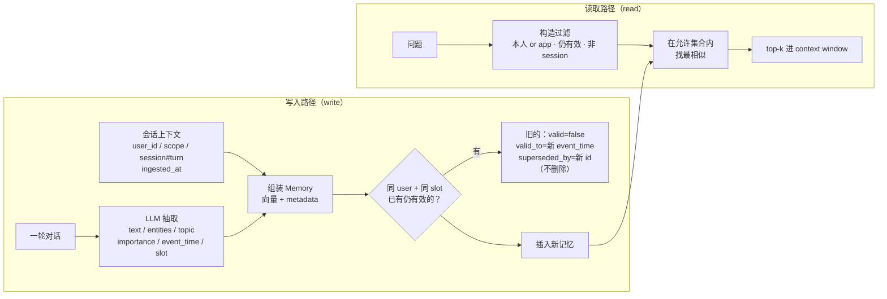

# 记忆库的 metadata 与过滤：Qdrant vs Postgres + pgvector（2026-11-15）

> 起因：W9 课上问「模糊的回忆放向量索引，怎么加 filter？chunking 时怎么把 filter 字段写好？metadata 在 Qdrant / Postgres 里怎么存？」
> 对应讲义：Practice I「Substrate follows query shape」、Act III「两个时钟 / 分区抽屉 / 写策略」、被遗忘权；以及我的 [权限感知检索笔记](../../course/ai-agents-week-09/permission-aware-retrieval.md)。

## 文件

| 文件 | 作用 |
| --- | --- |
| `common.py` | 玩具 embedding（字符三元组哈希，不需要 key）、`Memory` 记录、**写入路径** `build_memory`、**带 metadata 继承的切分** `chunk_document` |
| `data/events.jsonl` | 8 条 Harbor & Hearth 事件：Meera 的地址变更（会被取代）、Dev 的私人偏好、全店政策（app 作用域）、一条 session 草稿 |
| `qdrant_demo.py` | Qdrant 版：metadata 存在 **payload**；可直接跑（内置内存模式，不用 Docker） |
| `pg_demo.py` | Postgres + pgvector 版：metadata 存在**普通列 + JSONB**；需要 Docker 起 Postgres |
| `docker-compose.yml` | Qdrant v1.12.4 + pgvector 0.8.0 / PG16 |
| `requirements.txt` | 依赖 |

## 1. 设计图



**谁填哪些字段（要背）：**

| 字段 | 谁填 | 为什么 |
| --- | --- | --- |
| `user_id` `scope` `source` `ingested_at` | **代码**，从会话上下文取 | 权限和审计，绝不让 LLM 猜 |
| `text` `entities` `topic` `memory_type` `importance` `event_time` `slot` | **LLM 抽取**（结构化输出；本例用数据文件模拟） | 需要理解语义；代词要在写入时解析 |
| `valid` `valid_to` `superseded_by` | **后续写入时更新** | 取代 = 关闭有效窗口，不删除；改它们**不用重算向量** |

**切分时继承 metadata**：`chunk_document()` 把父文档的全部 filter 字段复制到每个 chunk，再加 `chunk_index`。检索是按 chunk 发生的，单独被捞出来的 chunk 必须自己说得清「属于谁、什么时候的」。

## 2. 两种库怎么存 metadata

| | Qdrant | Postgres + pgvector |
| --- | --- | --- |
| 一条记录 | point = id + vector + **payload（JSON）** | 一行 = 普通列 + `vector(256)` 列 + 可选 `jsonb` |
| 过滤索引 | `create_payload_index`（keyword / bool / datetime …），**要显式建** | B-tree、GIN（数组 / JSONB）、**部分索引** `WHERE valid` |
| 过滤方式 | 遍历 HNSW 时一起过滤；允许集合很小时改为暴力扫描 | 默认先 HNSW 再 `WHERE`；0.8 起 `hnsw.iterative_scan` 缓解 |
| 改 metadata | `set_payload` | `UPDATE` |
| 删除（被遗忘） | `delete(FilterSelector(...))` | `DELETE ... WHERE user_id = ...` |

## 3. 怎么跑

```bash
cd learning/2026-11-15-memory-store-filters
python -m venv .venv && source .venv/bin/activate
pip install -r requirements.txt

python qdrant_demo.py                      # 不用 Docker，内存模式

docker compose up -d                       # 起 Qdrant + Postgres
python qdrant_demo.py --url http://localhost:6333
python pg_demo.py
docker compose down -v                     # 用完删掉
```

## 4. Qdrant 版实测输出（内存模式，已跑通）

```
1) setup + write path
  supersede #1 -> #5  (supplier_sample_address)
  wrote 8 memories

2) NO filter: 'Where should supplier samples be shipped?'  <- old address and Dev's private note leak in
  #6   0.43  dev    user    Dev prefers to receive supplier samples at his home studio in Newark.
  #1   0.43  meera  user    Meera: ship every supplier sample to the Milpitas warehouse ...  [superseded by #5]
  #4   0.42  meera  user    Meera decided the Diya floor lamp will get a weighted brass base ...
  #5   0.39  meera  user    The warehouse moved: ship supplier samples to 44 Osgood Road, Fremont

3) recall filter for meera (mine + app, valid only, no session scratch)
  #4   0.42  meera  user    Meera decided the Diya floor lamp ...
  #5   0.39  meera  user    The warehouse moved: ship supplier samples to 44 Osgood Road, Fremont
  #3   0.37  meera  user    At the trade fair the Diya floor lamp kept wobbling ...
  #2   0.21  meera  user    Kolkata Brassworks orders take five weeks ...

4) as-of 2026-12-01 for meera (two clocks: what held then)
  #1   0.43  meera  user    Meera: ship every supplier sample to the Milpitas warehouse ...  [superseded by #5]

6) right to be forgotten: deleted every point with user_id=dev -> 7 left
```

**怎么读：**

- **2 不过滤**：Dev 的私人地址（别人的抽屉）和已被取代的旧地址都排在前面 = 两种泄漏
- **3 加过滤**：Dev 的和旧地址都消失，新地址留下；session 草稿（20% 折扣）也被挡住
- **4 as-of**：同一份数据，按 2026-12-01 的时间点查，查到的是**当时有效**的旧地址 → 「标成过期而不是删除」才做得到
- ⚠️ 玩具 embedding 只看字形，所以「灯」那条也挤了进来；换成真正的 embedding 后，排序会更合理。**过滤是否正确和 embedding 好坏无关**，这正是本例要看的

`pg_demo.py` **没有在我这边实跑**（沙盒里没有 Postgres），按 psycopg 3 / pgvector 0.3+ 的接口写的；第一次跑如果报错，把错误发给我。

## 5. 和课程的对应

| 本例 | 课程 |
| --- | --- |
| `user_id` + `scope`（session / user / app） | Act III 分区抽屉、ADK 的 `user:` / `app:` / `temp:` 前缀 |
| `event_time` + `ingested_at` | 两个时钟（上午实验 7） |
| `valid_to` + `superseded_by`，不删除 | invalidate 而不是 delete（实验 6、9；`us-east → us-west`） |
| 写入前按 slot 比对 | Mem0 的 ADD / UPDATE / DELETE / NOOP（本例用 slot 代替 LLM 判断） |
| `delete(user_id=dev)` | 被遗忘权 = 一份 GC 规格（还要清摘要、缓存、衍生事实，留删除记录） |
| 不过滤时的泄漏 | 权限感知检索：先过滤，再检索 |

## 6. 练习

1. 在 `events.jsonl` 加一条 Meera「仓库又搬回 Milpitas」，看 #5 会不会被取代、as-of 查询怎么变
2. 把 `recall_filter` 里的 `must_not session` 删掉，看 20% 折扣草稿会不会混进来
3. 把 `embed()` 换成真正的 embedding 模型，比较第 3 步的排序
4. 用 `chunk_document()` 切一段长会议记录写进去，检查每个 chunk 的 payload 是否都带 `user_id` 和 `event_time`
