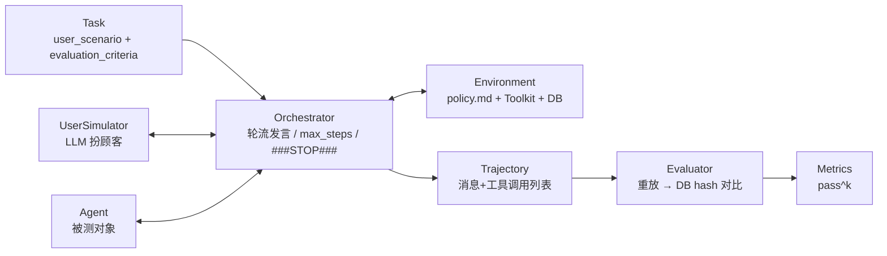

# tau2-bench 学习笔记（对照 Capstone）

> 一句话：tau2-bench 是一个**模拟器 + 结果判分器**。它让「被测 agent」和「LLM 扮演的顾客」在一个有真实数据库和工具的环境里对话，对话结束后**只看数据库最终状态**（外加少量"该说的话"）给 0/1 分，再用 pass^k 衡量稳定性。

---

## 1. 架构：五个零件



| 零件 | 作用 | 关键文件 |
|---|---|---|
| Domain / Environment | 一个领域 = `policy.md` + `tools.py`（`ToolKitBase` 子类）+ `db.json`（Pydantic `DB`）+ `tasks.json` + `split_tasks.json` | `src/tau2/domains/retail/`、`data/tau2/domains/retail/`、`src/tau2/environment/` |
| Agent | 被测对象。文本 agent 只需实现 `get_init_state()` 和 `generate_next_message()` 两个方法 | `src/tau2/agent/README.md`、`examples/agents/` |
| User Simulator | LLM 按任务里的 `reason_for_call / known_info / unknown_info / task_instructions` 扮演顾客，满意后输出 `###STOP###` | `src/tau2/user/`、`guidelines.py` |
| Orchestrator | 半双工轮流对话（文本）或全双工按 tick（语音）；控制 `max_steps=100`、`max_errors=10` | `src/tau2/orchestrator/` |
| Evaluator + Metrics | 判分、汇总 pass^k | `src/tau2/evaluator/`、`src/tau2/metrics/agent_metrics.py` |

注册：`src/tau2/registry.py` 里 `register_domain / register_tasks / register_agent_factory / register_user`。命令行 `tau2 run --domain retail --agent llm_agent --agent-llm ... --user-llm ...`。

---

## 2. 怎么切换被测 agent（考场固定，考生可换）

**核心原则：agent 只提出动作，执行的是考场。** 每一轮：

1. Orchestrator 把用户的话或工具结果交给 agent。
2. Agent 返回一条消息：要么是对用户说的话，要么是一个工具调用请求（工具名 + 参数）。
3. **Orchestrator 在 Environment 里执行工具**、修改 DB，把结果递回 agent。agent 从不直接碰数据库。
4. 所有往来都记进 trajectory，结束后 Evaluator 只看 trajectory 和 DB，不看 agent 内部。

所以 agent 内部是单个 LLM、ReAct、LangGraph 多 agent 还是规则脚本都无所谓，判分标准一样。

**接口很小**（参考 `examples/agents/minimal_text_agent.py`）：

```python
class MyAgent(HalfDuplexAgent):
    def __init__(self, tools, domain_policy): ...      # 考场发给你：工具清单 + 规则
    def get_init_state(self, message_history=None): ... # 开局状态
    def generate_next_message(self, message, state):   # 收到一条消息 → 回一条消息
        ...
        return assistant_message, state

def create_my_agent(tools, domain_policy, **kwargs):   # 工厂函数
    return MyAgent(tools, domain_policy, llm=kwargs.get("llm"))

registry.register_agent_factory(create_my_agent, "my_agent")
# 之后：tau2 run --domain retail --agent my_agent --agent-llm ...
```

**三个层级的切换**

| 换什么 | 怎么换 | 例子 |
|---|---|---|
| 换模型 | 改命令行参数，agent 不变 | `--agent-llm anthropic/claude-sonnet-5-5` 换成 `openai/gpt-5.5`（底层走 LiteLLM） |
| 换 agent 架构 | 注册新名字，用 `--agent` 选 | 内置 `llm_agent`、`llm_agent_gt`（能看参考答案的上限 agent）、`llm_agent_solo`；自己的 `my_agent` |
| 换外部系统 | 写一个适配器 agent，把消息转发给外部服务 | `src/experiments/agentify_tau_bench`：tau2 当考官（green agent，内部用 gym 的 `AgentGymEnv`），被测 agent 是独立的 A2A 服务（white agent）。被测方不用写 tau2 的 Python 类，但必须是 A2A 服务，并按约定的文本协议回复 `<json>{"name": 工具名或 "respond", "arguments": {...}}</json>` |

用户模拟器也是同样的插件机制：`registry.register_user(...)`，用 `--user` / `--user-llm` 选，内置 `user_simulator` 和 `dummy_user`。所以"顾客"一方也能单独换，例如换成另一个模型家族。

**为什么换了 agent 还能公平比较**

- 考题固定：任务里写好了顾客目标、已知和未知信息、参考解。
- 考场每次重置：每次运行都从 `db.json` 的新拷贝开始。
- 判分只看结果：重放轨迹里的工具调用，和参考解的 DB 对比（见第 3 节）。
- 统计稳定性：同一题跑 k 次，算 pass^k。

**对 capstone 的启示**

1. 把 LangGraph supervisor 包成一个 `HalfDuplexAgent` 适配器，就能和裸 Claude、DSPy 优化后的小模型、GRPO 小模型放进同一个考场，proposal 的五种条件对比就靠这个。
2. MCP server 属于考场一侧：agent 的每个调用都必须经过能记录的地方（动作日志）。agent 绕过它直接改 DB，相当于考生自己改卷子。
3. 基线也是插件：do-nothing、always-ask、always-escalate 各写约 20 行注册进去，用来证明判分器不会白送分。

---

## 3. 评分机制（最该吃透的部分）

**核心算法（`evaluator_env.py`）**

1. 拿一个全新环境，**按 agent 轨迹里记录的工具调用重放一遍** → 得到 predicted DB。
2. 再拿一个全新环境，重放任务里的 `evaluation_criteria.actions`（参考解）→ 得到 gold DB。
3. 比两个 DB 的 hash：相同 = 1，不同 = 0。

**要点**

- `actions` 只是**一条参考轨迹**，用来算出目标 DB，不要求 agent 走同一条路。只有 `reward_basis` 里写了 `ACTION` 才逐条比对（retail/airline/telecom 都不用）。
- 总分 = `reward_basis` 里各项的**乘积**：`DB`、`ENV_ASSERTION`（对最终环境跑断言函数）、`COMMUNICATE`（该告诉用户的信息，默认用 gpt-5.5 语义判官）、`NL_ASSERTION`（LLM 判官，WIP）、`ACTION`。
- 对话没有以 `AGENT_STOP / USER_STOP` 结束（超步数、报错太多等）直接 0 分。
- 缺少某项评判标准算 1 分（"没评"），不算 0。
- **pass^k** = `C(成功次数, k) / C(试验次数, k)`，每个任务算一次再取平均。意思是"随机抽 k 次全对的概率"。
- 诊断信号（不计入总分）：`partial_action_reward`（和参考轨迹的相似度，分 READ/WRITE）、`auth_classifier`（LLM 判断是否做了身份验证）、`review_llm_judge`（LLM 找 agent/用户错误）、`hallucination_reviewer`。

**重要推论：评分看的是轨迹，不是线上 DB。** predicted DB 是从 trajectory 里的 ToolCall/ToolMessage 重放出来的。所以 agent 的工具调用**必须经过 orchestrator 并被记录下来**。如果 agent 绕开 orchestrator，自己去调外部 MCP server，tau2 看不到那些写操作。

---

## 4. Retail 领域的实际情况

| 项 | 数值 / 内容 |
|---|---|
| 数据 | 50 种商品、500 个用户、1000 个订单 |
| 任务 | 114 个（train 74 / test 40）；2.0 的 text 基准冻结了 `retail_50` |
| 工具 | 15 个：7 个写（cancel / modify 地址、商品、支付 / return / exchange / 改用户地址），其余为读 + `calculate` + `transfer_to_human_agents` |
| reward_basis | 112 个任务是 `[DB, NL_ASSERTION]`（但 `nl_assertions` 为空，等于只看 DB），2 个是 `[DB]` |
| 规则在哪 | 业务规则硬编码在工具里，例如 `cancel_pending_order` 检查 `status == "pending"`、reason 只能是两种之一，不符合就 `raise ValueError` |

**几个对我们很关键的发现**

1. **订单没有日期字段**：retail 的数据模型和 db.json 里都没有下单或送达时间，所以"30 天退货窗口""45 天换货窗口"在 tau2 retail 里**无法表达**。
2. **没有优惠券或促销**：policy 里没有 coupon，也就没有叠加规则。
3. **不少 policy 条款 DB 查不出来**：比如"写操作前必须拿到用户明确的 yes""先认证再操作""一次只调一个工具"。DB hash 只能看到结果。agent 跳过确认但结果碰巧对，照样满分。
4. **"什么都不做"能拿分**：10/114 个任务的参考解里没有写操作，礼貌拒绝就是满分（约 9%）。我们 proposal 里的 do-nothing / always-escalate 基线就是专门测这个的。
5. **0/1 二值分**：没有部分分，也分不清"错在哪条规则""造成多大损失"。退款多给 500 美元和地址写错一个字母都是 0 分。

---

## 5. 能干啥 / 不能干啥

| 能干 ✅ | 不能干（或者需要我们自己做）❌ |
|---|---|
| 多轮对话 + 工具调用的端到端评测，带 LLM 用户模拟器 | 单步决策点评测：gym 只在整局结束时给稀疏奖励 |
| 基于结果的确定性 DB 判分，允许多条正确路径 | 按规则定位违规、按代价加权，以及部分分 |
| pass^k 稳定性指标、train/test split、冻结任务子集（`tau2 tasks subset`） | 时间窗口、优惠券叠加、规则冲突与优先级 |
| 任意模型（LiteLLM）或自定义 agent 类；A2A 适配见 `src/experiments/agentify_tau_bench` | 原生 MCP：工具是进程内 Python 函数，只有 FastAPI 的 `EnvironmentServer` |
| 组合式任务生成（telecom：`compose_tasks` 用 init_funcs / fix_funcs / env_assertions 拼出子任务） | 安全攻击场景（提示注入、假工具、工具行为漂移） |
| 双控制（telecom 里用户也有工具）、语音全双工、多语言、知识检索（banking_knowledge，tau3） | 跨会话记忆、多 agent 卖家协商、人工审批流 |
| Gymnasium 接口（`uv sync --extra gym`），可以当 RL 环境 | 成本、延迟、OpenTelemetry trace 报表；统计显著性（bootstrap CI） |
| 任务问题追踪（`task_issues/`）、判官校验流程 | 对"用户模拟器噪声"的根本解决。它仍然是 LLM，不确定性来源之一 |

---

## 6. 我们怎么借用：组件对照

**建议路线：把我们的商店做成一个新的 tau2 domain（比如 `commerce`），复用 tau2 的对话、模拟、pass^k 基础设施，判分器和决策点部分自己写。** 理由：对话循环、用户模拟器、轨迹格式、重放、pass^k 这些工程量大又容易出错，直接用；我们要的创新（违规代价判分、单步 reward、MCP、攻击、记忆）都在它没有的那一侧。

| Proposal 组件 | 复用 tau2 的什么 | 我们要加 / 改的 |
|---|---|---|
| 模拟商店 + 规则 | domain 结构：`data_model.py` / `tools.py` / `policy.md` / `db.json` | 订单加 `ordered_at / delivered_at`、`coupons`、`approvals`、卖家字段；注入固定的"当前时间"保证确定性 |
| 确定性 verifier | `EnvironmentEvaluator` 的"重放 → 对比"框架、`env_assertions` | 把 hash 对比改成 **DB diff → 规则检查器**：每个改动对照规则（窗口、叠加、审批、幂等），输出 `{rule_id, violated, cost}`；hash 匹配保留作为一个信号 |
| 20 个手算种子任务 | `tasks.json` 格式 + `reward_basis` | 每个种子任务写上预期的违规列表，单元测试 verifier 本身 |
| 150 个决策点（GRPO / DSPy） | `Task.initial_state.message_history`：可以把"对话前缀"直接写进任务 | 决策点 = 任务 + 历史前缀 + 候选动作；reward = 在 DB 副本上 `make_tool_call(候选动作)` 后跑同一个规则检查器。**这样 e2e 评测、DSPy metric、GRPO reward 共用一套规则**，正好是 proposal 的核心卖点 |
| 组合规则、按组合切分测试集 | telecom 的 `compose_tasks` / `SelectionSet` 模式 | 规则族（return / exchange / coupon / escalate / injection）做笛卡尔组合，test 用训练里没见过的组合 |
| 30 个 e2e 任务 × 4 次 | `tau2 run --num-trials 4`、`pass_hat_k()` | 加成本 / 延迟 / 违规率；配对 bootstrap CI |
| 用户模拟器换模型家族 | `--user-llm` 走 LiteLLM | 用非 Anthropic 模型扮顾客 |
| 测"所有 agent" | 自定义 `HalfDuplexAgent` + `register_agent_factory`；A2A 版 green/white agent | 写一个适配器把 LangGraph supervisor 包成 `HalfDuplexAgent`；外部 agent 走 A2A |
| 三个 MCP server | 工具定义可复用（`Tool.openai_schema`） | MCP server 只做同一套 toolkit 的薄封装。**关键：每次调用都要写进类型化动作日志**，或者让 verifier 直接读 MCP 背后的 DB 终态（见第 8 节第 2 条） |
| 攻击 / 记忆 / A2A 卖家 / RAG | banking_knowledge 的检索配置；agentify 实验 | 全部新建，作为新的任务族接入同一个检查器 |

---

## 7. 学习路径（第 1 周可以照做）

**Day 1：跑起来**

```bash
git clone https://github.com/sierra-research/tau2-bench && cd tau2-bench
uv sync --extra gym --extra dev      # Python 3.12–3.13
cp .env.example .env                 # 填 key（LiteLLM，Anthropic 也可以）
tau2 intro
tau2 run --domain retail --agent-llm anthropic/claude-sonnet-5-5 \
  --user-llm <另一家族模型> --num-tasks 5 --num-trials 2
tau2 view --file data/simulations/<run>
```

**Day 2：按这个顺序读代码**

1. `docs/evaluation.md` → `src/tau2/evaluator/AGENTS.md` → `evaluator.py`、`evaluator_env.py`
2. `data/tau2/domains/retail/policy.md` + `src/tau2/domains/retail/tools.py`（看规则是怎么写进工具里的）
3. `src/tau2/data_model/tasks.py`（`Task / EvaluationCriteria / InitialState / EnvAssertion`）
4. `src/tau2/environment/environment.py` 的 `set_state`（重放逻辑）
5. `src/tau2/orchestrator/orchestrator.py`（终止条件）、`src/tau2/user/guidelines.py`
6. `examples/agents/minimal_text_agent.py`、`custom_agent_eval.py`
7. `src/tau2/domains/telecom/tasks/`（组合式任务生成）、`src/tau2/gym/README.md`

**Day 3–4：动手实验（每个都对应 proposal 的一个论点）**

- **E1 do-nothing agent**：写一个只回"抱歉无法处理"的 agent，跑 retail test，看它拿多少分。用来论证"结果判分需要配合违规检查"。
- **E2 跳过确认**：改 system prompt 让 agent 不问 yes 直接执行，看 DB 分是否不变。用来论证"过程规则需要动作日志"。
- **E3 mini domain**：复制 `mock` domain，加一个带 `delivered_at` 的退货工具和 30 天规则，写 3 个任务 + 1 个 `env_assertion`，跑通 `tau2 run --domain <ours>`。
- **E4 决策点原型**：用 `initial_state.message_history` 造一个停在"该不该退款"的前缀，比较 3 个候选动作在 DB 副本上的检查结果。这就是 GRPO reward 的雏形。
- **E5 pass^k 抖动**：同一任务跑 4 次，人工读 2 条失败轨迹，区分 agent 错误和用户模拟器错误。

---

## 8. 坑与注意事项

1. **版本不可比**：2.0 和 1.x 分数不能比（retail 换了 50 个任务、判官换了、prompt 加了条款）。引用排行榜数字时注明版本；要复现旧数字用 `v1.0.1` tag。
2. **MCP 和重放的冲突**：tau2 靠轨迹重放还原 DB。如果我们的 agent 通过 MCP 直接改外部 DB，要么把每次 MCP 调用回写成 ToolCall/ToolMessage，要么 verifier 改成直接读真实终态 + 动作日志（proposal 的写法），用 tau2 重放做交叉校验。
3. **LLM 判官的成本和不确定性**：`COMMUNICATE` 默认调 gpt-5.5，NL 断言用 gpt-5.4-mini。我们的主分应该完全不依赖 LLM，判官只做诊断；需要时用 `--communicate-scorer substring`。
4. **时间要确定**：引入日期规则后，"今天"必须写死在任务或 DB 里，不能用系统时间，否则重放结果会变。
5. **幂等**：tau2 的写工具没有幂等键，同一个写调用两次会生效两次。proposal 要求"重试的写操作不会重复生效"，需要自己加 `idempotency_key`。
6. **用户模拟器噪声**：tau2 自己也维护了 `task_issues/` 记录有问题的任务。我们计划人工读 30 条对话，这一步要保留。
7. **License 与引用**：MIT。报告里引用 tau-bench / tau2 / tau3（τ-Knowledge）论文，`README.md` 末尾有 bibtex。

---

## 9. 一句话定位我们的贡献

> tau2-bench 回答的是"终态对不对"；我们要回答"**违反了哪条规则、代价多大、在哪一步做错的**"，并让同一套规则同时成为评测指标、DSPy metric 和 GRPO reward。tau2 提供对话模拟和 pass^k 的底座，我们在它的 `Evaluator` 和 `Task.initial_state` 这两个扩展点上搭自己的 verifier。
